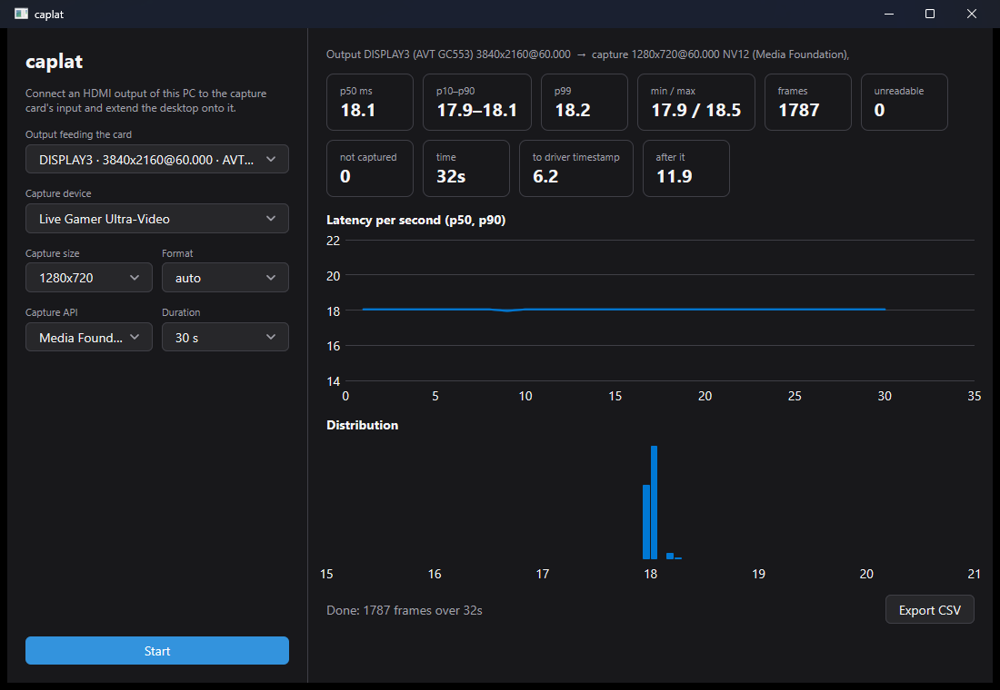

# caplat

**Measure a capture card's latency with nothing but an HDMI cable.**

caplat feeds a capture card from your own PC and times every frame:
from the moment the frame starts leaving the GPU (its vblank) to the moment
your capture software has it in memory. No photodiode, no high-speed camera,
no special hardware. It runs in about 30 seconds and reports every frame, so
you see both the latency and the jitter.

```
output   \\.\DISPLAY3 AVT GC553  3840x2160@60.000
capture  "Live Gamer Ultra-Video"  1280x720@60 nv12  preset low-latency

latency vblank -> arrival over 22s
  n=1197  min 35.0  p10 35.1  p50 35.2  p90 35.5  p99 35.8  max 35.9  mean 35.2 ms
```

It comes as a command-line tool and a desktop app (built with
[MyGo](https://github.com/egoist/mygo)).



## How it works

1. Connect an HDMI output of the PC to the capture card's **input** and
   extend the desktop onto it. Windows sees the card as another monitor.
2. caplat opens a full-screen window on that output and shows, on every
   refresh, a barcode along the top edge: a 24-bit frame number with a
   CRC-4 and sync cells, sized relative to the width so it survives any
   scaling the card does.
3. For every frame it asks DXGI when that frame started scanning out
   (`IDXGISwapChain::GetFrameStatistics`, a QueryPerformanceCounter time of
   the vblank). The PC's own compositor and presentation queue are not
   counted.
4. It reads the card back through ffmpeg's DirectShow input, decodes the
   barcode in every captured frame and notes when the frame arrived, on the
   same QueryPerformanceCounter clock.
5. latency = arrival − vblank, for every frame. Statistics live in a fixed
   0.1 ms histogram, so a run can last hours.

What the number includes: the HDMI transmission of the frame (a frame has to
be received whole before a card can deliver it, 16.7 ms at 60 Hz), the card's
processing and scaling, USB transfer, the driver, DirectShow and ffmpeg.
That is the latency a streaming or remote-play app built on the card
actually pays.

## What it found

AVerMedia **GC553** (Live Gamer Ultra), 4K60 in, 1280x720@60 NV12 capture:

| ffmpeg options | p50 | p10–p90 |
|---|---|---|
| `low-latency` preset (`-fflags nobuffer -flags low_delay -probesize 32 -analyzeduration 0`, `-fps_mode passthrough`) | **35.2 ms** | 0.4 ms |
| `default` (plain `ffmpeg -f dshow`) | 59.6 ms (or 76 ms, decided at start-up) | 15 ms |

With default options ffmpeg probes the input while the device opens and that
read-ahead never drains, because frames are then read exactly as fast as
they arrive: one or two frames of extra latency, chosen at random each time
the capture starts, plus about a frame of jitter.

### Long runs: one frame that never comes back

Over minutes the low-latency capture of the GC553 sometimes steps from
35 ms to 52 ms, exactly one frame more, and stays there until the capture is
restarted. It happens on its own (after about 15 s in one run, 95 s in
another, not at all in a 90 s run) and also right after a deliberate CPU
stall; once it has happened, further stalls cause long spikes but no second
step.
Shrinking ffmpeg's real-time buffer (`-rtbufsize 2M`) does not prevent it,
so the extra frame is queued below ffmpeg, in DirectShow or the driver. Any
software reading the card this way can carry that frame; a long `--interval`
run shows it as a step.

caplat keeps the display awake during a run and stops with an error if the
barcode stops being shown (display asleep, window covered), instead of
measuring garbage.

## Install

You need [ffmpeg](https://ffmpeg.org/download.html) on your `PATH` (for now;
a native Media Foundation reader is planned).

- **Desktop app**: download `caplat-gui.exe` from the
  [releases](https://github.com/virgil724/caplat/releases).
- **CLI**: download `caplat.exe`, or `go install github.com/virgil724/caplat/cmd/caplat@latest`.

## Use

```
caplat list
```
lists the displays (marking the primary one and those whose EDID name looks
like a capture card) and the DirectShow devices with their modes.

```
caplat run --device "Live Gamer Ultra-Video" --duration 30s
```

| Flag | Default | |
|---|---|---|
| `--display` | `auto` | `\\.\DISPLAY3`, `DISPLAY3`, or `auto` (the one display whose EDID name looks like a capture card) |
| `--device` | auto | DirectShow video device; auto picks the capture card |
| `--size` | `1280x720` | capture size |
| `--pixel-format` | `auto` | `nv12`, `yuyv422`, `mjpeg`, ...; auto prefers uncompressed formats |
| `--preset` | `low-latency` | ffmpeg buffering: `low-latency` or `default` |
| `--ffmpeg-in`, `--ffmpeg-out` | | extra ffmpeg options before `-f dshow` / after `-i` |
| `--duration` | `30s` | `0` runs until you stop it |
| `--interval` | `1m` | print statistics every interval (to see drift on long runs) |
| `--csv` | | write every matched frame (frame, vblank, arrival, latency) |
| `--force` | | allow measuring on the primary display |

Press **Esc** or click the barcode window to stop early; the results so far
are printed. caplat refuses the primary display unless you pass `--force`,
because the barcode covers the whole screen.

The frame rate follows the output's refresh rate, fractional ones included
(`60000/1001`). Both the output mode and the capture mode are printed with
every result: Windows may drive the card at 4K or 30 Hz without telling you.

## How this compares

| Tool | Measures | Needs |
|---|---|---|
| **caplat** | capture card + capture software | an HDMI cable |
| [NVIDIA Holoscan latency tool](https://docs.nvidia.com/holoscan/archive/2.4.0/latency_tool.html) | video I/O loopback | NVIDIA dev kits, AJA cards, Linux |
| [disguise capture latency](https://help.disguise.one/hardware/performance/capture-latency-methodology) | capture cards (barcode in frame) | disguise media servers |
| [Time Sleuth](https://consolemods.org/wiki/AV:Time_Sleuth), Leo Bodnar lag tester | displays | a photodiode device |
| stopwatch + phone camera | anything | patience; ±1 frame |

## Build

```
go build ./cmd/caplat                      # CLI, any recent Go
cd gui && go build -ldflags -H=windowsgui  # GUI, Go 1.27.4+ (MyGo)
```

`go test ./...` covers the barcode, the matcher, the histogram, struct
layouts of the Windows bindings and ffmpeg argument building; the GUI has
view tests (`cd gui && go test`).

caplat is pure Go: Direct3D 11, DXGI and the Win32 calls go through
`syscall` by COM vtable index (see `internal/win`).

## Roadmap

- Native Media Foundation capture, to separate the card from ffmpeg/DirectShow.
- Linux: DRM vblank events and V4L2.

## License

MIT
